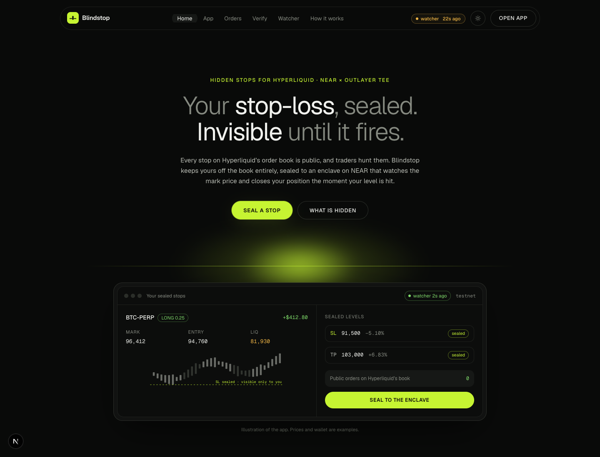
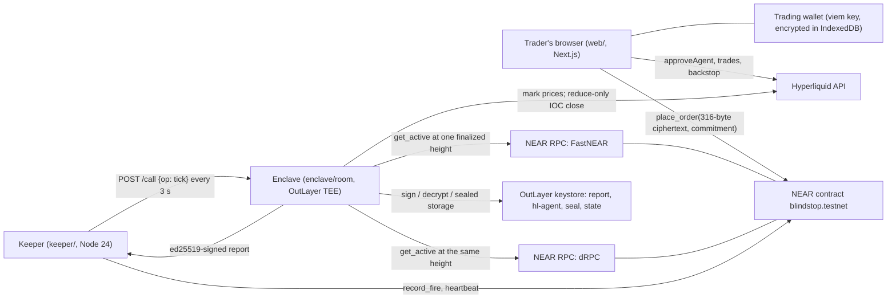
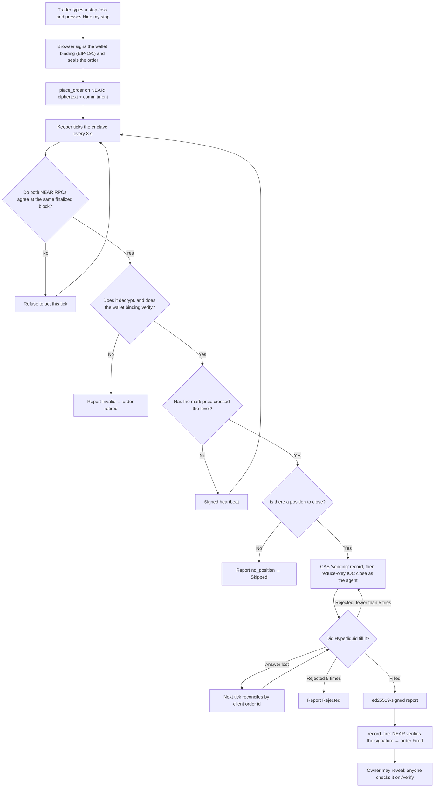

# Blindstop

**Hidden stop-losses and take-profits for Hyperliquid.**

[](https://github.com/mrfomoweb3/blindstop/actions/workflows/ci.yml) [](LICENSE)  

Blindstop keeps your stop-loss and take-profit levels off Hyperliquid's public order book. Your browser seals them, NEAR stores only the sealed copy, and a secure enclave on NEAR (OutLayer, Intel TDX) watches the price and closes your position when your level is hit. It is for Hyperliquid traders who are tired of trading with their stops on display. Nothing else hides *where your stops are* on Hyperliquid.

Built at NEAR HACKATHON. Tracks: Privacy & Private AI · Unstoppable DeFi · AI Security & Defense.


## Demo

> 🎥 Demo video: _add link_ (3-minute walkthrough; source in [video/](video/))



- Live app (testnet): **https://blindstop.mrfomolabs.xyz/**. Try [Check a stop](https://blindstop.mrfomolabs.xyz/verify) with stop `6`, or the live [Status](https://blindstop.mrfomolabs.xyz/watcher) page.
- Plain-English guide (PDF): [docs/explainer/Blindstop-plain-English-guide.pdf](docs/explainer/Blindstop-plain-English-guide.pdf)
- Contract on NEAR testnet: [`blindstop.testnet`](https://testnet.nearblocks.io/address/blindstop.testnet)

## Contents

- [Problem](#problem)
- [Solution](#solution)
- [How to test](#how-to-test)
- [Architecture](#architecture)
- [Flowchart](#flowchart)
- [Tech stack](#tech-stack)
- [Getting started](#getting-started)
- [Project structure](#project-structure)
- [Deployment](#deployment)
- [Usage / API](#usage--api)
- [Status: every claim and its proof](#status-every-claim-and-its-proof)
- [Known limitations](#known-limitations)
- [Roadmap](#roadmap)
- [Contributing](#contributing)
- [License](#license)
- [Team and acknowledgements](#team-and-acknowledgements)

## Problem

Hyperliquid runs a fully on-chain order book. Every order is public, including stop-losses and take-profits. One request returns any wallet's trigger levels:

```http
POST https://api.hyperliquid.xyz/info
{"type": "frontendOpenOrders", "user": "0x…"}
```

- Tracking tools add those levels up across wallets and show where stops, take-profits and liquidations cluster ([CoinMarketMan: liquidity clusters on Hyperliquid](https://coinmarketman.com/blog/liquidity-clusters-on-hyperliquid-how-to-read-where-the-market-will-move-next--en/), [stop placement using liquidation clusters](https://coinmarketman.com/blog/stop-loss-placement-using-liquidation-clusters-on-hyperliquid--en/)).
- Visible positions get hunted. Public whale positions on Hyperliquid were followed and liquidated in plain view ([Cointelegraph](https://cointelegraph.com/news/hyperliquid-whale-loss-100-million-bitcoin-dips-below-105)), and in the XPL pre-market a few wallets cleared the book and forced mass liquidations ([The Defiant](https://thedefiant.io/news/defi/whale-trades-on-hyperliquid-wipe-out-xpl-order-book-triggering-mass-liquidations)).
- Existing fixes don't cover Hyperliquid. [Aster's hidden orders](https://docs.asterdex.com/trading/perpetuals/order-types/hidden-order) work only on Aster, and only for limit orders. [Gloam](https://gloam.trade/docs/privacy-model) hides *who* funded a wallet; what the wallet does after that is public.

The traders hurt most are ordinary ones: a stop sitting in a visible cluster is the price someone else aims for.

## Solution

Your stop never touches the order book until the moment it fires. The browser encrypts it to an enclave key, NEAR stores the ciphertext and a commitment, and the enclave alone can read it. The enclave checks the mark price every few seconds; when your level is crossed it sends a reduce-only close as your approved agent and returns a signed receipt that the NEAR contract verifies.

**Key features**

- **Sealed in the browser.** Orders are padded to 256 bytes and encrypted (X25519 + HKDF-SHA256 + ChaCha20-Poly1305), so every envelope on NEAR is 316 bytes whatever is inside. The market and the trading wallet are inside the ciphertext.
- **Watched inside a TEE.** An OutLayer project (Intel TDX) reads active orders from two NEAR RPCs at one finalized height (refusing if they differ) and mark prices from Hyperliquid. A keeper can delay ticks but cannot change outcomes.
- **Closes safely.** Reduce-only IOC closes with compare-and-swap state, reconciliation by client order id, and up to 5 retries. The agent key never enters module memory.
- **Settled and proven on NEAR.** The contract verifies every enclave report with `ed25519_verify` against a pinned key. After an order closes, its owner can reveal it and anyone can check it against the commitment stored at placement.
- **Wallet binding.** Every order carries an EIP-191 signature from the trading wallet naming the NEAR account, so nobody can point the shared agent at your wallet.
- **Built-in trade panel and safety net.** Open long or short (isolated, 1–10×) in the app, then hide its stop. An optional public backstop near liquidation protects you if the watcher is ever offline.
- **Plain language.** The app is written for traders, not developers. Technical detail sits behind "Technical details" toggles.

### What is hidden, and what is still public

| Hidden | Still public |
|---|---|
| Stop and take-profit levels, sizes, slippage: nothing on Hyperliquid's book until one fires | The position itself: size, entry, **liquidation price** |
| Which market a NEAR order is for | The close order and fill when a stop fires |
| Which Hyperliquid wallet it protects | The NEAR account that placed orders, how many, and when |
| Ciphertext length (every envelope is 316 bytes) | That the wallet approved an agent (one agent address for every user) |
| With Gloam funding: which main wallet funded the trading wallet, unless amounts or timing link them | Gloam deposits and cash-outs at the vault |

Details and trust assumptions: [docs/threat-model.md](docs/threat-model.md).

## How to test

### No accounts needed (about 5 minutes)

```bash
git clone https://github.com/mrfomoweb3/blindstop.git && cd blindstop
rustup target add wasm32-wasip2
pnpm install
make test       # Rust core + signing vectors + contract + TypeScript
make harness    # builds the real OutLayer wasm and runs 14 scenarios under wasmtime
```

Passing looks like: every `cargo test` prints `test result: ok`, Vitest reports no failures, and the harness prints 14 `ok - …` lines followed by `HARNESS PASSED`.

### In the browser (testnet)

```bash
cp web/.env.example web/.env.local
cd web && pnpm dev        # http://localhost:3000
```

You need a NEAR testnet wallet (Meteor, Intear or MyNearWallet) and test USDC on Hyperliquid testnet from the [faucet](https://app.hyperliquid-testnet.xyz/drip). The faucet only pays wallets that have deposited on Hyperliquid mainnet; [docs/spikes.md](docs/spikes.md#blocked-on-funds) has the details.

**Try this**

1. Open **Status** (`/watcher`). Expected: "Protection is on" with the last price check a few seconds ago (needs a running keeper).
2. Open **Check a stop** (`/verify`), enter `6`, press **Check**. Expected: **Genuine**, a real order sealed in a browser, opened by the enclave and revealed on testnet.
3. Open **My positions** (`/app`) and follow the four steps: sign in with NEAR, create a trading wallet (made and encrypted in your browser), add test funds, turn on protection. Expected: each step ticks green.
4. In **Open a trade**, pick BTC, Long, $50, 3×, then **Open long**. Expected: "Opened a long of … BTC".
5. On the position card, type a stop-loss below the price and press **Hide my stop**. Expected: "Your stop-loss is hidden and being watched", and **Orders anyone can see: 0**.
6. Open **History** (`/app/orders`). Expected: the stop listed as Active on NEAR.

### Against the live contract and enclave

```bash
OUTLAYER_PAYMENT_KEY=… node scripts/attacks.ts   # → ALL ATTACKS REFUSED
```

A saved run is in [docs/evidence/attacks-testnet.log](docs/evidence/attacks-testnet.log).

## Architecture



- **Web app (`web/`)** onboards the trader, keeps the trading key encrypted in the browser, seals orders to the enclave's x25519 key, and places them on NEAR. It also trades, verifies revealed orders and shows live status.
- **NEAR contract (`contracts/blindstop`)** stores only ciphertext and commitments, verifies enclave reports against the pinned ed25519 key, emits NEP-297 events, refunds storage when an order closes, and lets the owner reveal a closed order.
- **Enclave (`enclave/room` on `enclave/core`)** is a `wasm32-wasip2` OutLayer component. It decrypts orders, checks the wallet binding, reads prices, decides, closes positions as the approved agent and signs reports. Its manifest allows HTTPS-only callers and exactly four network hosts.
- **Keeper (`keeper/`)** is stateless. It calls the enclave every few seconds and submits the signed reports and heartbeats with a function-call key limited to `record_fire` and `heartbeat`. It serves `/health` and `/metrics`.
- **Shared library (`packages/shared`)** holds the TypeScript formats, sealing, Hyperliquid signing and NEAR transaction signing. It is checked byte for byte against the Rust core and the official Python SDK.

## Flowchart



## Tech stack

| Area | Tools |
|---|---|
| Frontend | Next.js 15.5, React 19.2, Tailwind CSS 4, `@near-wallet-selector` 10.1 (Meteor, Intear, MyNearWallet), `@near-js/transactions`, viem, zod |
| Enclave | Rust, `wasm32-wasip2`, OutLayer SDK (`outlayer`, `wasi-http-client`), RustCrypto (`x25519-dalek`, `ed25519-dalek`, `k256`, `chacha20poly1305`, `hkdf`, `sha2`, `sha3`), `borsh` |
| Blockchain | NEAR (`near-sdk` 5.29, Rust 1.95), OutLayer TEE (Intel TDX), Hyperliquid perps |
| Keeper | Node 24 (native TypeScript), zod; Dockerfile and `fly.toml` included |
| Shared | TypeScript, `@noble/curves`, `@noble/hashes`, `@noble/ciphers` |
| Testing | `cargo test`, Vitest, `wasmtime` harness, signing vectors from `hyperliquid-python-sdk` 0.24.0 |
| Tooling | pnpm 10 workspaces, Make, GitHub Actions (Rust, contract, TypeScript, gitleaks full-history scan) |

## Getting started

### Prerequisites

- Node.js 22.18 or newer (24 recommended) and pnpm 10
- Rust with the `wasm32-wasip2` target. The contract uses Rust 1.95, pinned in `contracts/blindstop/rust-toolchain.toml`
- `cargo-near`, only to build the contract
- A NEAR testnet account, to use the app
- To run a keeper: an OutLayer payment key issued by the project's operator account, and a NEAR function-call key for the keeper account

### Installation

```bash
git clone https://github.com/mrfomoweb3/blindstop.git
cd blindstop
rustup target add wasm32-wasip2
pnpm install
```

### Environment variables

**Web (`web/.env.local`).** Every value is compiled into public JavaScript, so none of them are secret.

| Variable | Purpose | Required |
|---|---|---|
| `NEXT_PUBLIC_NEAR_NETWORK` | `testnet` or `mainnet` | Yes |
| `NEXT_PUBLIC_CONTRACT` | Blindstop contract account (`blindstop.testnet`) | Yes |
| `NEXT_PUBLIC_NEAR_RPCS` | Comma-separated NEAR RPC URLs | Yes |
| `NEXT_PUBLIC_HL_NETWORK` | Hyperliquid network: `testnet` or `mainnet` | Yes |
| `NEXT_PUBLIC_OUTLAYER_API` | OutLayer API base URL | Yes |
| `NEXT_PUBLIC_OUTLAYER_PROJECT` | OutLayer project (`owner/name`) | Yes |
| `NEXT_PUBLIC_KEEPER_URL` | The keeper's public `/health` URL, shown on `/watcher` | No |

**Keeper (`keeper/.env`, never commit it)**

| Variable | Purpose | Required |
|---|---|---|
| `NEAR_NETWORK` | `testnet` or `mainnet` | Yes |
| `NEAR_RPC` | Comma-separated RPCs, rotated on failure (default FastNEAR, dRPC, near.org) | No |
| `BLINDSTOP_CONTRACT` | Contract account | Yes |
| `KEEPER_ACCOUNT` | NEAR account that submits reports | Yes |
| `KEEPER_PRIVATE_KEY` | Function-call key limited to `record_fire` and `heartbeat`. If unset, read from `~/.near-credentials` | No |
| `OUTLAYER_PROJECT` | OutLayer project (`owner/name`) | Yes |
| `OUTLAYER_PAYMENT_KEY` | `owner:nonce:secret`, owned by the project's operator account | Yes |
| `OUTLAYER_API` | OutLayer API base URL | No |
| `TICK_INTERVAL_MS` | Milliseconds between ticks (default 3000) | No |
| `HEARTBEAT_EVERY` | Submit a heartbeat every N ticks (default 10) | No |
| `HEARTBEAT_MAX_GAP_MS` | Also heartbeat when this long has passed without one, so `/watcher` stays fresh when enclave runs are slow (default 20000; 0 = off) | No |
| `CALL_TIMEOUT_MS` | Enclave call timeout (default 120000) | No |
| `PORT` | Port for `/health` and `/metrics` (default 8787) | No |
| `LOG_LEVEL` | Log level (default `info`) | No |

### Run locally

```bash
# web app against testnet
cp web/.env.example web/.env.local
cd web && pnpm dev                     # http://localhost:3000

# keeper (separate terminal)
cp keeper/.env.example keeper/.env     # fill in the two keys
make keeper                            # http://localhost:8787/health
```

## Project structure

```
contracts/blindstop   NEAR contract (near-sdk 5): orders, settlement, reveal, events
enclave/core          pure logic: formats, crypto, triggers, Hyperliquid signing, tick state machine
enclave/room          the OutLayer component (wasm32-wasip2): binds core to OutLayer storage, keys, HTTP
enclave/harness       runs the real wasm under wasmtime against fixtures and a signature-checking fake /exchange
packages/shared       TypeScript: formats, sealing, Hyperliquid signing, NEAR tx signing, contract views
keeper                Node 24 service: tick loop, settlement, /health, /metrics, Dockerfile, fly.toml
web                   Next.js app: onboarding, trade panel, hidden stops, history, proof checks, status
scripts               attacks.ts, golden-path.ts, harness.sh, hl_vectors.py
docs                  spikes, threat model, operations, demo script, evidence, plain-English guide
deploy/testnet.json   public deployment facts (contract, project, wasm hash, enclave keys)
video                 the demo film (HyperFrames project)
```

## Deployment

| What | Where |
|---|---|
| Contract | [`blindstop.testnet`](https://testnet.nearblocks.io/address/blindstop.testnet), init tx `5kcM7eQJKWr3h395gFcbSEBzCEx3hWrPZTn4dtzFJRuE` |
| OutLayer project | `blindstop-watch.testnet/blindstop-watcher` |
| Enclave wasm | sha256 `4bc6d150f2405b9b757b386e8cd560eaebc6fdfbdb2ad680373085637e6f639a` ([wasm](https://test.fastfs.io/blindstop-watch.testnet/outlayer.testnet/4bc6d150f2405b9b757b386e8cd560eaebc6fdfbdb2ad680373085637e6f639a.wasm)) |
| Enclave keys (pinned in the contract) | x25519 `edb14684…2e19d09`, ed25519 `8e355b62…05a7293` |
| Hyperliquid agent | `0xad9043b5f362ea82986e035d6ddb2a684f01e077` |
| Keeper account | `blindstop-keeper.testnet` |
| Keeper service | [blindstop-keeper.fly.dev/health](https://blindstop-keeper.fly.dev/health) (Fly.io, one always-on machine) |
| Web app | [blindstop-five.vercel.app](https://blindstop-five.vercel.app) (Vercel, root directory `web`) |

All of these are in [deploy/testnet.json](deploy/testnet.json). To deploy your own contract, enclave and keeper, see [docs/operations.md](docs/operations.md).

```bash
make build-contract                                   # contracts/blindstop/target/near/blindstop_contract.wasm
BLINDSTOP_CONTRACT=you.testnet make build-enclave     # prints the wasm sha256
make web                                              # production build of the web app
```

The keeper runs on Fly.io from `keeper/fly.toml` and `keeper/Dockerfile` (the root `.dockerignore` keeps the build context to the files it needs):

```bash
fly apps create <name>
grep -E '^(KEEPER_PRIVATE_KEY|OUTLAYER_PAYMENT_KEY)=' keeper/.env | fly secrets import -c keeper/fly.toml --stage
fly deploy . -c keeper/fly.toml --remote-only
```

Run one keeper per NEAR key: two processes signing with the same key race on its nonce.

## Usage / API

### Contract methods

| Method | Who | What it does |
|---|---|---|
| `place_order(ciphertext, commitment)` | Trader | Stores a sealed order (attach storage deposit) |
| `cancel_order(order_id)` | Order owner | Cancels an active order and refunds storage |
| `record_fire(report, sig)` | Anyone | Settles an enclave report after `ed25519_verify` |
| `heartbeat(report, sig)` | Anyone | Records a signed enclave heartbeat |
| `reveal(order_id, plaintext)` | Order owner | Publishes a closed order's plaintext, checked against its commitment |
| `get_active`, `get_order`, `get_orders_by_owner`, `get_enclave_keys`, `get_heartbeat`, `get_config` | Anyone (view) | Read state |
| `set_enclave_keys`, `pause`, `unpause`, `set_max_active_per_owner`, `transfer_ownership` | Contract owner | Admin |

Example view call:

```bash
near view blindstop.testnet get_order '{"order_id": "6"}' --networkId testnet
```

### Keeper endpoints

```bash
curl http://localhost:8787/health    # ok, last tick, last attestation URL, latency, heartbeat tx
curl http://localhost:8787/metrics   # Prometheus metrics
```

### Make targets

```bash
make help   # test, harness, build, keeper, attacks, golden, vectors, verify
```

## Status: every claim and its proof

| Claim | Proof |
|---|---|
| Rust Hyperliquid signing is byte-identical to the official Python SDK | `cargo test -p blindstop-core --test hl_vectors` (5 orders; vectors from `hyperliquid-python-sdk==0.24.0` via `scripts/hl_vectors.py`) |
| Browser signing (`approveAgent`, `withdraw3`, backstop, trade panel) matches the Python SDK | `pnpm --filter @blindstop/shared test` |
| Rust, TypeScript and the contract agree on every byte (orders, commitments, envelopes, reports) | `packages/shared/test/vectors.json`, checked by `cargo test`, Vitest and the contract tests |
| The real OutLayer wasm runs end to end locally | `make harness` → `HARNESS PASSED` (14 scenarios: fire, idempotency, no-position, invalid and hostile orders, RPC disagreement, input injection, rejection retries, lost-answer reconciliation, confirm ticks) |
| Enclave keys are stable inside the real TEE | 3 calls of `pubkeys` returned identical keys ([docs/spikes.md](docs/spikes.md), S3) |
| A TEE-signed heartbeat verifies on chain | tx `DPo2D7wJWecNExA4n8UoG6t2mtvm5EJUjQq32JQXdisH`; live age on `/watcher` |
| A browser-sealed order is opened and settled by the real enclave | order 6: report settled by a third party, tx `AjQgGT7C6aQmDTJCGKpYBnkU1FytQRR5HAj79WGTTDTH`; revealed, tx `5zPJSAfpZ4edx32eadspJGUUEos9FQV3aFSE4XVSUtPE` |
| Attacks are refused on testnet | `node scripts/attacks.ts` → `ALL ATTACKS REFUSED` ([log](docs/evidence/attacks-testnet.log)) |
| A sealed stop fires on Hyperliquid testnet and is recorded `Fired` | **Open.** Needs a funded Hyperliquid testnet wallet; `make golden` runs it ([docs/spikes.md](docs/spikes.md#blocked-on-funds)) |

## Known limitations

- **Liveness:** if no keeper runs, stops do not fire. The app shows heartbeat age and offers a public backstop near liquidation, placed with your own key.
- **Latency:** a stop fires within the tick interval (3 s) plus one enclave run (about 1.5–3 s) after the cross. Fast wicks can fill worse than a native stop.
- **The liquidation price is public,** as it is for every Hyperliquid position.
- **Trust:** Intel TDX and OutLayer's keystore; the project owner (every version they publish holds the same keys); the contract owner (can rotate pinned keys). Ownership is not yet locked or moved to a DAO.
- **Keepers:** the enclave keys are bound to the operator account, so a second keeper needs an operator-issued payment key. It cannot be fully permissionless with OutLayer's current key model.
- **Funding:** Gloam's SDK has no one-step cash out to Arbitrum, so private funding is a documented manual flow.
- **Markets:** main-dex Hyperliquid perps only; partial IOC fills are reported as filled with the filled size.

## Roadmap

- [x] Sealed orders on NEAR with commitments, reveal and storage refunds
- [x] Enclave on OutLayer: decrypt, watch, close, sign reports
- [x] Hyperliquid signing matched byte for byte to the official SDK
- [x] Keeper with `/health`, `/metrics` and a function-call-only key
- [x] Web app with trade panel, hidden stops, history, proof check and status
- [x] 14-scenario harness on the real wasm; 9 attacks refused on testnet
- [ ] Live golden path recorded on Hyperliquid testnet (needs test USDC)
- [x] Hosted web app (Vercel) and keeper (Fly.io)
- [ ] Lock contract ownership or move it to a DAO
- [ ] More than one keeper operator
- [ ] One-step private funding once Gloam supports cash out to Arbitrum

## Contributing

1. Fork the repo and create a branch: `git checkout -b my-change`.
2. Make your change. Keep Rust, TypeScript and the contract in byte agreement: if you touch a format, regenerate the vectors with `make vectors`.
3. Run `make verify` (all tests plus the harness). CI runs the same checks plus a gitleaks scan.
4. Never commit secrets: `keeper/.env` and `web/.env.local` are gitignored.
5. Open a pull request that says what changed and how you tested it.

## License

MIT, see [LICENSE](LICENSE).

## Team and acknowledgements

- Built by [mrfomoweb3](https://github.com/mrfomoweb3) and [nddic](https://github.com/nddic) at NEAR HACKATHON. Other entry by the same team: [VEIL](https://github.com/mrfomoweb3/veil); the two projects share no code.
- [NEAR](https://near.org) and [OutLayer](https://outlayer.ai) for the contract platform and TEE execution; OutLayer's documentation and connector examples informed the manifest and sealed-storage patterns.
- [Hyperliquid](https://hyperliquid.xyz); signing vectors come from the official `hyperliquid-python-sdk` (0.24.0).
- Libraries: `near-sdk`, `@near-wallet-selector/*`, `@near-js/transactions`, the OutLayer SDK, `viem`, `@noble/*`, RustCrypto crates, `borsh`, `wasmtime`, Next.js, Tailwind CSS, zod, Vitest. `@gloamtrade/sdk` was evaluated for funding.
- Code was written with Claude Code.
